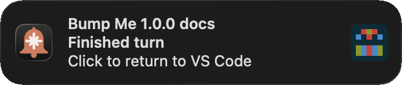
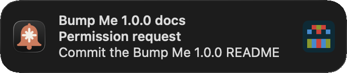
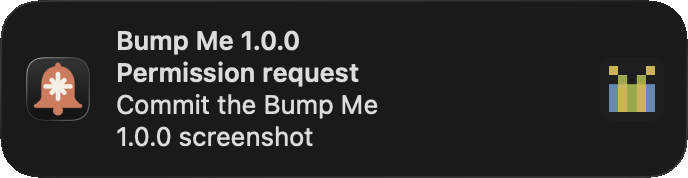
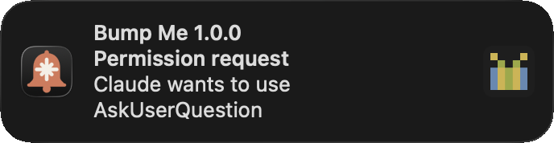
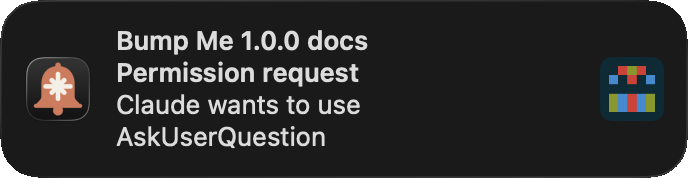
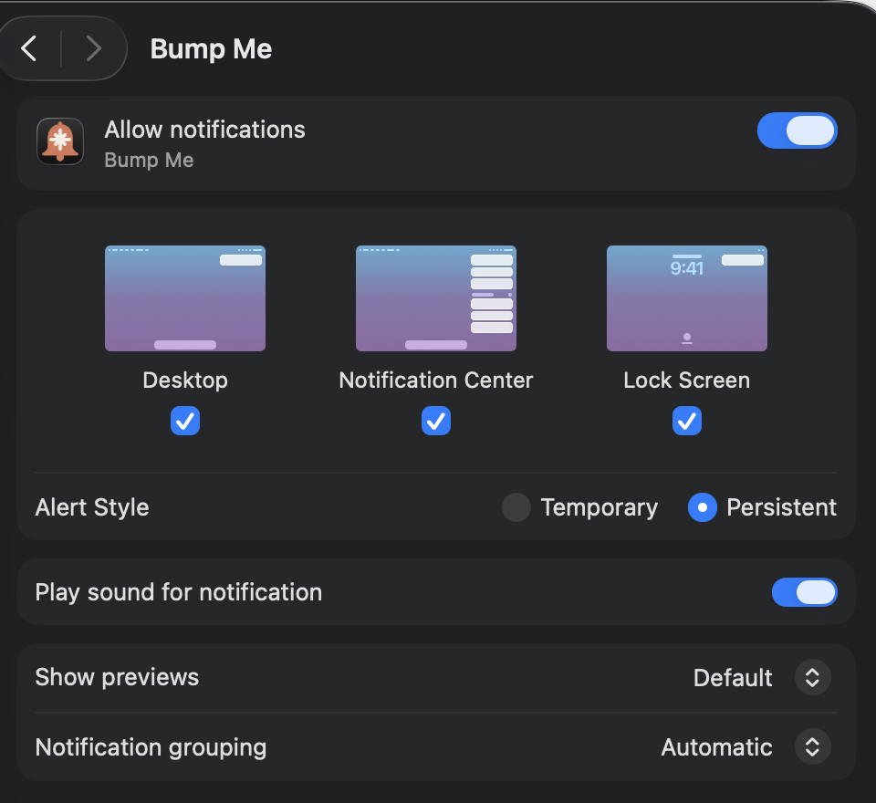

# Bump Me

Working with an LLM agent is often asynchronous in nature. A turn starts, you
suspect it'll take a while to finish, so you switch to Slack (or YouTube, if
we're being honest), and promptly forget everything you've ever known or done.
Bump Me posts a notification when Claude Code finishes a turn or needs your
input on a request to help keep you on track.

<p align="center">
  
  
  
</p>
<p align="center">
  
  
  
</p>

Click on a notification to jump back to the window and get back to it. Bump Me
adds a little Identicon to the right so you can visually tell the windows apart
a bit easier.

## Prerequisites

Bump Me is mac only. It needs these on your `PATH` to install:

- `brew`
- `node`, version 22+
- `pnpm`
- `code`
- A recent `claude` (this was tested on 2.1.311)
- `clang`, `make`, `git`, and `lipo`, which build the notifier. Apple's Command
  Line Tools are an easy way to get them: `xcode-select --install`.

## Install

To install from scratch, clone the repo and run the bootstrap script. It checks
the prerequisites, installs `just` with Homebrew if missing, then installs the
Bump Me VS Code extension, Claude Code plugin, and `Bump Me.app`

```sh
git clone https://github.com/diminishedprime/bump-me.git
cd bump-me
zsh scripts/bootstrap.zsh
```

To reinstall later, run:

```sh
just install
```

### After installing

Allow notifications when the first alert asks for permission. You'll also want
to turn these notifications on to **Persistent** unless you like using
Notification Center, for some reason.

<p align="center">
  
</p>

## Uninstall

To remove the Bump Me VS Code extension, Claude Code plugin, and `Bump Me.app`,
run:

```sh
just uninstall
```

## Acknowledgements

Bump Me posts its alerts with [terminal-notifier] by Eloy Duran and Julien
Blanchard, under the MIT license. `just install` builds version 3.1.0 from
source with the bell icon from `assets/bell.svg`.

<!-- prettier-ignore-start -->
[terminal-notifier]: https://github.com/julienXX/terminal-notifier
<!-- prettier-ignore-end -->
